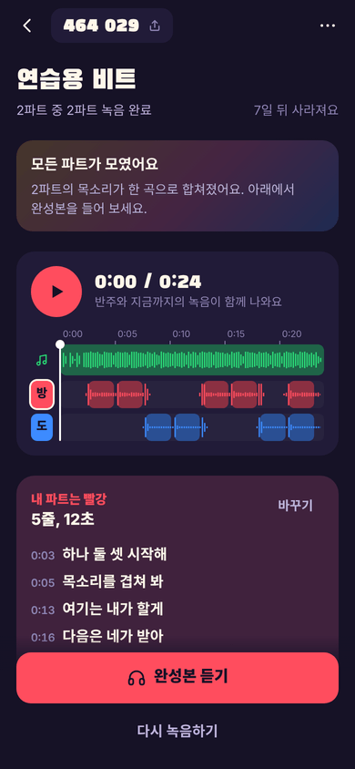
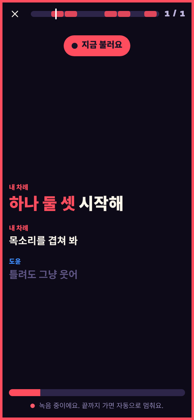
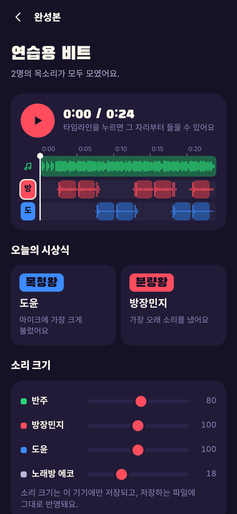

# 떼창방

노래 한 곡을 친구들과 파트 나눠 부르고, 한 곡으로 합치는 웹앱입니다.
방을 만들면 **6자리 임시 번호**가 나오고, 친구들은 그 번호만 넣으면 설치·가입 없이 들어와 각자 편한 시간에 자기 파트를 녹음합니다.

| 방 화면 | 녹음(노래방식) | 완성본 |
|---|---|---|
|  |  |  |

## 할 수 있는 것

- **가수·곡 이름으로 시작**: 이름을 넣으면 곡 목록이 나오고, 고르면 **가사와 줄별 타이밍**을 찾아옵니다. 노래 파일이 없어도 됩니다.
- **유튜브 영상을 반주로**: 유튜브 링크를 붙여 넣으면 그 영상을 방 안에서 그대로 틀면서 녹음합니다. 음원을 내려받거나 서버에 저장하지 않습니다(아래 "유튜브 반주" 참고).
- **부를 구간 고르기**: 가사 줄을 눌러 "여기부터 ~ 여기까지"를 고릅니다. 첫 후렴까지를 추천 구간으로 먼저 골라 둡니다. 뮤직비디오처럼 음원과 길이가 다른 영상은 가사를 밀어 맞출 수 있습니다.
- **파트 나누기**: 인원수만 고르면 자동 배정(반복되는 줄은 다같이, 나머지는 부르는 시간이 고르게), 룰렛, 줄별 직접 지정. AI를 켜면 가사 흐름을 보고 추천합니다.
- **녹음**: 반주(영상)가 4초 먼저 나오고 내 차례에 가사에 색이 들어옵니다. 내 줄만 녹음에 남고, 음량은 자동으로 맞춥니다.
- **합쳐 듣기**: 색깔 트랙 타임라인, 사람별 음량·에코, 녹음별 싱크 미세 조정, 재미로 주는 시상식.
- **블라인드 모드**: 다 모일 때까지 서로의 녹음을 숨겼다가 한꺼번에 공개.
- **임시 방**: 7일 뒤 방과 녹음이 자동으로 지워집니다(방장이 30일까지 연장 가능).
- **노래 파일로도**: mp3·m4a·wav·화면 녹화 영상을 올려 반주로 쓸 수 있습니다. 이 경우 완성본을 반주까지 합친 MP3 한 개로 저장할 수 있습니다. 파일도 링크도 없으면 내장된 연습용 비트로 바로 해볼 수 있습니다.

## 유튜브 반주

유튜브에서 음원을 뽑아 오는 방식은 쓰지 않습니다. 유튜브 약관이 금지하고, 무료 서버에서는 유튜브가 막아서 안정적으로 돌지도 않습니다. 대신 공식 플레이어(IFrame Player API)로 영상을 **그대로 재생**하고, 친구들의 목소리를 그 영상에 맞춰 얹습니다.

- 영상은 늘 화면에 보이는 플레이어로 재생됩니다. 영상 앞에 광고가 붙으면 끝난 뒤에 시작합니다.
- 올린 사람이 다른 사이트에서의 재생을 막아 둔 영상은 쓸 수 없습니다. 방을 만들 때 미리 틀어 보고 알려 줍니다.
- 영상의 소리는 파일에 담을 수 없어서, 완성본 화면의 "파일로 저장"은 **목소리만** 합친 MP3를 만듭니다. 영상과 함께 남기려면 완성본을 재생하면서 휴대폰의 화면 녹화를 켜세요.
- 파일 반주는 녹음에 새어 든 반주로 싱크를 자동으로 재지만, 유튜브 영상의 소리는 앱이 들여다볼 수 없습니다. 그래서 **기기마다 처음 한 번**은 "싱크 미리 맞춰 두기"(이어폰을 마이크에 대고 시험 소리로 재기)를 하거나 들어보는 화면의 막대로 맞춰야 합니다. 한 번 맞추면 기억합니다.
- 휴대폰 브라우저(특히 아이폰)는 영상을 직접 한 번 눌러야 재생을 허락하는 경우가 있습니다. 그럴 때는 화면에 안내가 나옵니다.

### 영상까지 자동으로 찾게 하기 (선택)

기본 상태에서는 "유튜브에서 이 곡 찾기"로 유튜브를 열어 링크를 복사해 붙여야 합니다. 서버에 YouTube Data API 열쇠를 넣어 두면 곡을 고르는 순간 영상까지 자동으로 골라 줍니다(무료 할당량으로 하루 100번쯤 찾을 수 있습니다).

1. [Google Cloud 콘솔](https://console.cloud.google.com)에서 프로젝트를 만들고 **YouTube Data API v3**를 "사용"으로 켭니다.
2. "사용자 인증 정보 → 사용자 인증 정보 만들기 → API 키"로 열쇠를 만듭니다.
3. Cloudflare 대시보드 → Workers 및 Pages → `ttechangbang` → 설정 → 변수 및 비밀 → 추가에서 유형을 **비밀**로, 이름을 `YOUTUBE_API_KEY`로 넣고 저장합니다. (내 컴퓨터에서 돌릴 때는 `YOUTUBE_API_KEY=... npm start`)

## 무료로 인터넷에 올리기 (Cloudflare)

마이크는 `https://` 주소에서만 켜지므로, 휴대폰으로 친구들과 쓰려면 인터넷에 올려야 합니다.
Cloudflare 무료 플랜만으로 돌아가도록 만들었습니다(서버 Workers, 저장소 D1, AI는 Workers AI 무료 할당량).

### 방법 1 — 명령어 없이 (GitHub + 버튼)

1. [GitHub](https://github.com)에 가입하고 **공개(Public)** 저장소를 하나 만듭니다.
2. 이 폴더의 파일을 저장소에 올립니다. `node_modules`, `dist`, `data` 폴더는 올리지 않습니다(없어도 됩니다).
3. 아래 주소에서 `<내아이디>/<저장소이름>`만 바꿔 브라우저로 엽니다.
   ```
   https://deploy.workers.cloudflare.com/?url=https://github.com/<내아이디>/<저장소이름>
   ```
4. Cloudflare에 가입·로그인하고 GitHub 연결을 허용한 뒤 **Deploy**를 누릅니다. 데이터베이스(D1)와 AI 연결은 자동으로 만들어집니다.
5. 몇 분 뒤 `https://ttechangbang.<내계정>.workers.dev` 같은 주소가 나옵니다. 이 주소가 떼창방입니다.

저장소를 Cloudflare에 연결해 두면, 저장소에 새 내용을 올릴 때마다 자동으로 다시 배포됩니다.

### 방법 2 — 명령어로

```bash
npm install
npx wrangler login      # 브라우저에서 Cloudflare 로그인
npx wrangler deploy     # 화면을 만들고(빌드) 올립니다. 처음 올릴 때 D1 데이터베이스를 자동으로 만들어 줍니다
```

### AI 기능 (선택)

`wrangler.jsonc`의 `"ai"` 줄이 있으면 아래 기능이 켜집니다.

- **검색어 다듬기**: 한글로 적은 가수·곡 이름으로 못 찾았을 때 공식 표기로 바꿔 한 번 더 찾습니다 — `@cf/meta/llama-3.3-70b-instruct-fp8-fast`
- **파트 추천**: 가사 흐름을 보고 나눠 줍니다 — 같은 모델
- **가사 자동 싱크·받아쓰기** (파일 반주에서만): `@cf/openai/whisper-large-v3-turbo`
- 모델을 바꾸려면 Worker 환경 변수 `AI_ASR_MODEL`, `AI_TEXT_MODEL`에 모델 이름을 넣습니다.
- Workers AI의 하루 무료 할당량 안에서만 쓰도록 횟수를 막아 뒀습니다. 할당량을 넘기거나 AI가 실패하면 직접 맞추는 방법으로 그대로 진행할 수 있습니다.
- AI를 아예 쓰지 않으려면 `"ai"` 줄을 지우면 됩니다. 나머지 기능은 그대로 동작합니다.

## 내 컴퓨터에서 돌려 보기

Node.js 22.13 이상이 필요합니다.

```bash
npm install && npm run build
npm start              # http://localhost:8787
```

- 방·녹음은 `data/ttechang.db` 파일에 저장됩니다.
- `localhost`에서는 마이크가 켜지지만, 같은 와이파이의 휴대폰에서 `http://192.168.x.x:8787`로 열면 브라우저가 마이크를 막습니다. 휴대폰에서 쓰려면 위 방법으로 올려 주세요.
- 개발 중에는 `npm start`를 켜 둔 채 다른 창에서 `npm run dev`(http://localhost:5173)를 쓰면 고친 내용이 바로 보입니다.
- Cloudflare 환경 그대로 돌려 보려면 `npm run build && npm run cf:dev`.

## 폴더 구조

```
web/                 화면 (React + TypeScript, Vite)
  src/screens/       홈 · 방 만들기 · 방 · 녹음 · 완성본 · 파트 수정
  src/screens/create/ 방 만들기의 단계들 (곡 찾기, 영상 고르기, 구간 고르기, 탭 싱크)
  src/components/    색깔 트랙 타임라인
  src/lib/audio/     녹음·재생·싱크·MP3 변환·분석
  src/lib/yt/        유튜브 플레이어 감싸기, 영상 시계와 소리 시계 맞추기, 영상에 목소리 얹기
  src/lib/           파트 배정, 가사 다루기, 곡 찾기, 서버 통신, 이 기기 저장값
server/
  api.js             방·녹음 API (Cloudflare와 Node가 같은 코드를 씁니다)
  find.js            곡·가사·유튜브 영상 찾기
  ai.js              Workers AI 호출
  worker.js          Cloudflare Worker 진입점
  node-server.mjs    Node 서버 진입점 (node:sqlite)
tests/               API 테스트, 브라우저 전체 흐름 테스트, 가짜 유튜브·가짜 검색 서버
wrangler.jsonc       Cloudflare 설정
```

### 싱크를 맞추는 방법

**파일 반주**

1. 재생과 녹음을 같은 오디오 시계(AudioContext)에 올리고, 마이크로 들어온 소리마다 그 시계의 프레임 번호를 기록합니다.
2. 녹음에 새어 든 반주를 찾아 "소리가 나가서 다시 들어오기까지" 걸린 시간을 잽니다. 노래하지 않는 조용한 순간만 골라 재기 때문에 이어폰에서 아주 조금 새는 소리로도 잴 수 있습니다.
3. 못 잰 경우엔 이 기기에서 전에 맞춘 값 → 브라우저가 알려 주는 값 순서로 씁니다. 들어보기 화면에서 막대로 고치거나, 이어폰을 마이크에 대고 시험 소리로 자동 측정해 방금 녹음을 다시 맞출 수 있습니다.
4. 저장하는 모든 소리 파일 앞에 짧은 표시음을 붙여 둡니다. MP3는 브라우저마다 앞부분 지연이 달라서, 풀어낸 뒤 표시음 위치를 찾아 그 뒤부터 쓰면 어느 기기에서든 같은 자리가 됩니다(표시음은 잘려서 들리지 않습니다).

**유튜브 반주**

영상의 소리는 다른 사이트의 플레이어 안에 있어서 같은 시계에 올릴 수 없습니다. 대신 두 가지 차이값을 계속 잽니다.

- 영상 시계: 플레이어가 알려 주는 "영상 위치와 그 위치를 잰 시각"으로, 지금 영상이 몇 초를 들려주는지.
- 소리 시계: 브라우저가 알려 주는 "지금 스피커로 나가는 위치"로, 우리 AudioContext의 몇 초가 지금 귀에 들리는지.

이 둘로 "영상의 s초가 들리는 순간의 소리 시계 값"을 구해, 녹음을 자를 때와 목소리를 얹을 때 똑같이 씁니다. 녹음 도중에 영상이 멈칫하거나 소리 처리가 밀려 차이값이 옮겨 가면, 줄마다 그 줄을 부르던 때의 값으로 맞춥니다. 재생 중에 30ms 넘게 어긋나면 목소리를 다시 맞춥니다.

## 테스트

```bash
npm test               # 신호 처리·시계 맞추기·파트 배정·가사 다루기 단위 테스트
npm run test:api       # 서버 API (방, 자리, 녹음, 블라인드, 만료, 곡·가사·영상 찾기)
npm start &            # 아래 두 개는 서버가 떠 있어야 합니다
node tests/e2e.mjs         # 브라우저: 방 만들기 → 두 사람 녹음 → 합치기 → MP3, 싱크 오차 측정
node tests/e2e-create.mjs  # 브라우저: 파일 올리기·탭 싱크·블라인드·브라우저 마이크 경로
node tests/e2e-ai.mjs      # 브라우저: AI 화면 흐름 (가짜 AI)
node tests/e2e-yt.mjs      # 브라우저: 곡 찾기 → 유튜브 반주 방 → 영상에 맞춰 녹음·합쳐 듣기 (가짜 플레이어)
node tests/e2e-ytapi.mjs   # 브라우저: 유튜브 IFrame API 를 타는 길 (흉내 플레이어)
```

Cloudflare Worker로 띄운 서버를 검사하려면 `BASE=http://127.0.0.1:8787`처럼 주소를 넘깁니다.

테스트 환경에서는 진짜 유튜브와 바깥 검색 서버에 닿을 수 없어서, 유튜브 쪽은 가짜 플레이어로만 확인했습니다. 실제 유튜브 영상과 실제 휴대폰에서의 동작은 올린 뒤 직접 확인이 필요합니다.

## 알아 둘 점

- **저작권**: 원곡 음원·영상·가사에는 권리자가 있습니다. 친구끼리 즐기는 용도로 쓰고, 완성본을 공개된 곳에 올릴 때는 문제가 될 수 있습니다. 법률 자문이 아니며, 공개 서비스로 운영하려면 전문가 확인이 필요합니다.
- **방 번호**: 6자리 숫자를 아는 사람은 누구나 들어올 수 있습니다. 틀린 번호를 반복해 넣으면 잠시 막히지만, 민감한 내용을 올리는 곳은 아닙니다.
- **이어폰**: 줄 이어폰이 가장 잘 맞습니다. 블루투스 이어폰은 마이크를 켜면 음질이 떨어지거나 소리가 늦을 수 있고, 유튜브 반주에서는 싱크가 더 크게 어긋날 수 있습니다. 이어폰 없이 하는 모드는 반주를 걸러 주지만 목소리가 조금 뭉개질 수 있습니다.
- **앱 안 브라우저**: 카카오톡·인스타그램 안에서 열면 마이크가 막힐 수 있어, 기본 브라우저로 열도록 안내가 뜹니다.
- **가사**: 공개 가사 모음(LRCLIB)에서 찾아오므로 없는 곡도 있고 틀린 곳도 있을 수 있습니다. 못 찾으면 직접 붙여 넣고 탭으로 타이밍을 맞출 수 있습니다.
- **가사 수정**: 방을 연 뒤에는 누가 부를지만 바꿀 수 있고, 가사 글자와 타이밍은 방을 새로 만들어야 바꿀 수 있습니다.
- **원곡 보컬 분리**는 들어 있지 않습니다. 원곡 영상을 고르면 원래 가수 목소리와 함께 들립니다. 반주만 원하면 유튜브에서 MR·노래방 영상을 골라 주세요.
- **유튜브 앱에서 바로 보내기**: 안드로이드에서 떼창방을 홈 화면에 추가해 두면, 유튜브의 "공유"에서 떼창방을 골라 그 영상으로 바로 방 만들기를 시작할 수 있습니다.

## 쓰인 것들

`NOTICE.md`를 봐 주세요.
